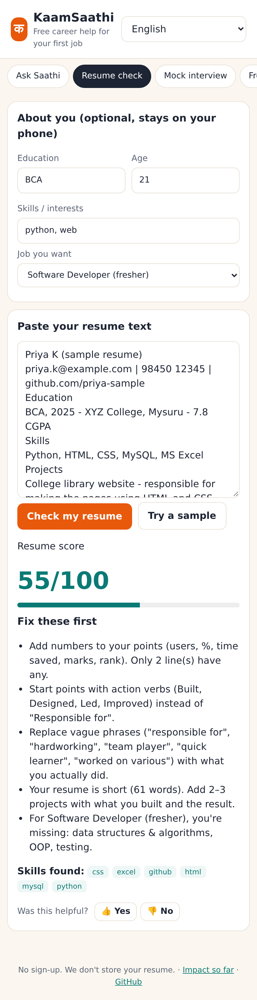
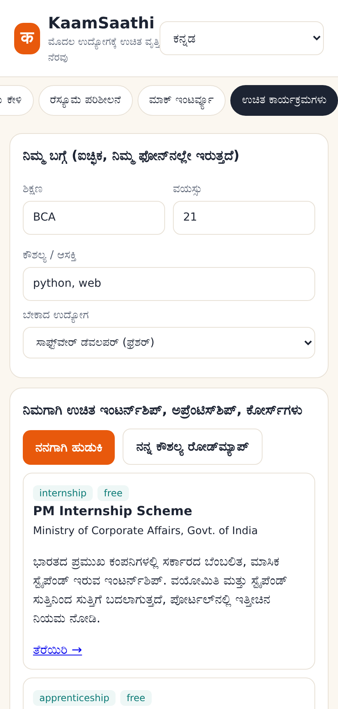
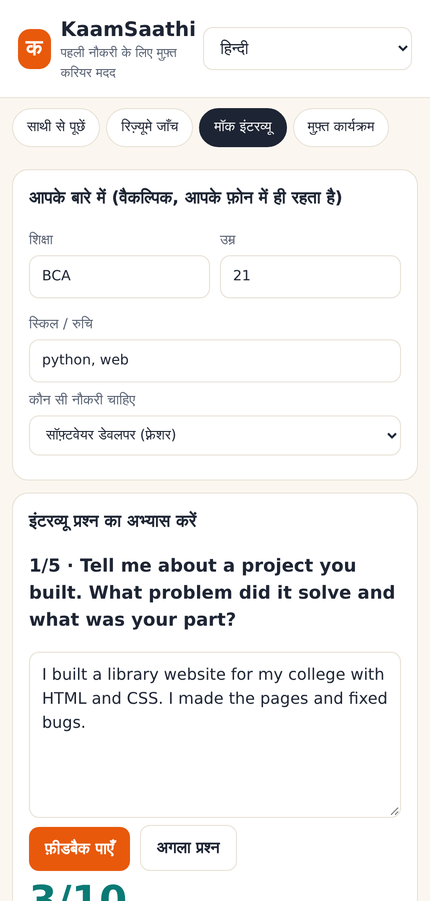

# KaamSaathi — a free AI companion for India's first-time job seekers

**Track:** Tech Employment for Youth · **Code for a Billion — Bharat Agentic-AI Hackathon 2026** · MIT licensed

KaamSaathi ("work companion") helps a student, fresher, ITI/diploma holder or first-generation graduate get from
"I don't know where to start" to "I've applied" — in **English, Hindi or Kannada**, on a cheap phone, with **no sign-up**.

- **Resume check** — a 0–100 score with a transparent breakdown and the exact fixes to make, plus AI rewrites of the weakest lines (never invents facts; uses placeholders like `[X users]`).
- **Free programmes finder** — matches you to *official, free* government and non-profit routes into work: PM Internship Scheme, National Apprenticeship (NAPS), NATS, AICTE Internship Portal, National Career Service, Skill India Digital / PMKVY, DDU-GKY, NPTEL, SWAYAM and more, filtered by your education and age.
- **Mock interview** — role-specific questions (software developer, web developer, data analyst, customer support/BPO, QA tester) with a checklist score and AI coaching.
- **Skill roadmap** — what you already show, what's missing for the job you want, and a week-by-week plan with free resources.
- **Agent chat** — "Ask Saathi" plans and chains the tools above by itself (e.g. *check my resume → build a roadmap for the gaps → find matching apprenticeships*) and shows its steps.

| Resume check | Free programmes (ಕನ್ನಡ) | Mock interview (हिन्दी) |
|---|---|---|
|  |  |  |

> Live app: _deploying (link added here once live)_ · Impact dashboard: `/impact` on the live app

## The problem

| | |
|---|---|
| Youth (15–29) unemployment, India, 2025 | **9.9%**; urban youth **13.6%**; urban young women **18.9%** |
| Unemployment among graduates (15+), 2025 | **11.2%**, vs **3.1%** for all workers |
| New graduates every year | about **1.09 crore** (2022-23, provisional) |
| Graduates judged employable | **56.35%** (India Skills Report 2026) |

Sources: [PLFS Annual Report 2025, PIB](https://www.pib.gov.in/PressReleasePage.aspx?PRID=2246009) ·
[Lok Sabha Q. 2512, 3 Aug 2026](https://sansad.in/getFile/lsapps/loksabhaquestions/annex/188/AU2512_0kojdw.pdf) ·
[Lok Sabha Q. 1260, 8 Dec 2025](https://sansad.in/getFile/loksabhaquestions/annex/186/AU1260_jB8RSD.pdf) ·
[India Skills Report 2026 summary](https://www.raysolute.com/india-employability-gap-2026.html)

The free help already exists — the government runs paid internships, apprenticeships and free training — but a
first-time job seeker from a small town rarely knows which one fits them, gets no feedback on a resume that
says "hardworking team player", and walks into their first interview unprepared. Private career coaching costs
thousands of rupees and is in English. Every month of searching is a month of lost income for the family.

## How it works

```
Browser (mobile-first, EN / HI / KN)
   │
FastAPI ── /api/chat ──► Agent (Gemini function calling, up to 5 tool rounds)
   │                         │  falls back to a rule-based planner if no key / LLM error
   │                         ▼
   ├── /api/resume ───► analyze_resume     (deterministic scoring + localised fixes) + AI rewrite
   ├── /api/opportunities ► find_opportunities (curated list of official free programmes, filtered by education/age)
   ├── /api/roadmap ──► skill_roadmap      (role skill maps → gaps → weekly plan + free resources)
   ├── /api/interview ─► interview_question / evaluate_answer (+ AI coaching)
   ├── /go/{id} ──────► counted redirect to the official portal
   └── /api/impact ───► anonymous metrics (Postgres on Render, SQLite locally)
```

Design choices:
- **Works without AI.** Every feature has a deterministic engine, so the app still helps when the LLM quota runs out, and its scores are explainable and testable.
- **Honest by construction.** The agent may only recommend programmes returned by its tools (a curated list of official portals); it is told never to invent jobs, stipends or deadlines. Scheme terms change between rounds, so summaries point users to the portal for current terms.
- **Private.** No accounts. Resume text is processed in memory and never stored. Metrics are anonymous counts tied to a random browser id.

## Measuring impact

The live `/impact` page reads straight from the database: people helped (distinct anonymous browsers), resume
checks, **people whose resume score went up on a re-check and the average gain** (before/after), interview answers
scored, programme searches, **clicks through to official portals** ("sent to apply"), and 👍/👎 helpfulness votes,
broken down by language. See [`docs/IMPACT.md`](docs/IMPACT.md) for what has actually been measured so far.

## Run it locally

```bash
git clone https://github.com/Rahulrachu/kaam-saathi && cd kaam-saathi
python -m venv .venv && source .venv/bin/activate
pip install -r requirements.txt
cp .env.example .env            # optional: add GEMINI_API_KEY for AI rewrites and the LLM agent
uvicorn app.main:app --reload   # open http://localhost:8000
python -m pytest -q             # tests
```

Environment variables: `GEMINI_API_KEY` (optional), `GEMINI_MODEL` (default `gemini-3.5-flash-lite`),
`DATABASE_URL` (optional Postgres for metrics; SQLite file otherwise).

## Deploy

One click on Render with the included `render.yaml` (free web service + free Postgres): New → Blueprint → this repo,
then paste a Gemini key when asked. Or `docker build -t kaam-saathi . && docker run -p 8000:8000 kaam-saathi`.

## Project layout

```
app/agent.py      Gemini tool-calling agent + rule-based fallback
app/tools.py      resume scoring, programme matching, roadmap, interview scoring
app/i18n.py       English / Hindi / Kannada strings for the rule engine
app/metrics.py    anonymous impact metrics
data/             curated official programmes and role skill maps / interview questions
static/           the web app and the /impact page
tests/            unit + API tests (Gemini mocked)
```

## Adding a programme or role

Programmes live in `data/opportunities.json` (official URL, eligible education levels, age range, tags, and a one-line
summary in all three languages). Roles live in `data/roles.json`. Pull requests welcome — especially more Indian
languages and state schemes.

## License

MIT © 2026 Rahul S R
